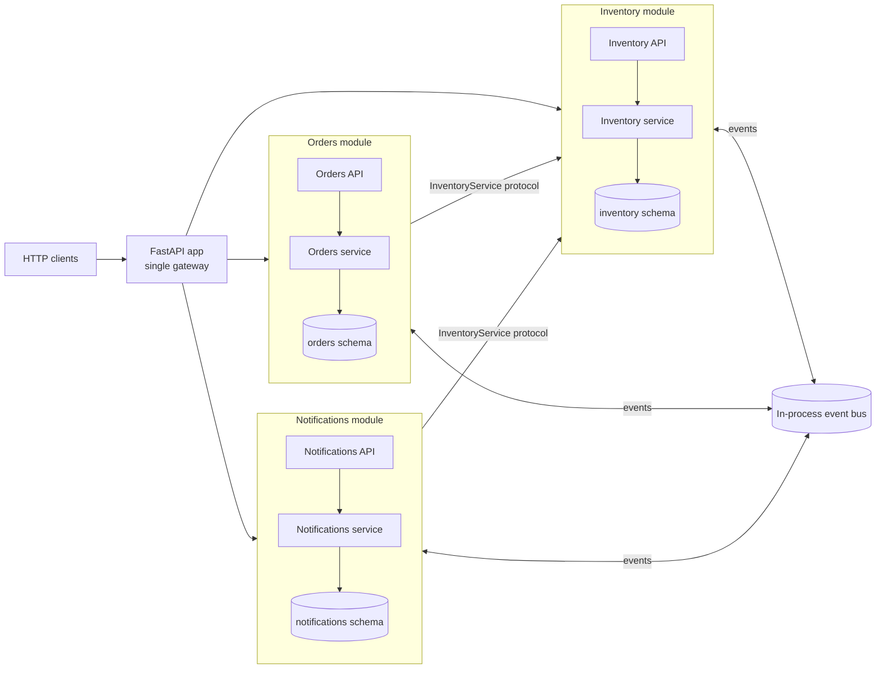

# FastAPI Modular Monolith

One FastAPI application, one deployment, one PostgreSQL database, two business
modules (`inventory`, `orders`), one additional example module
(`notifications`), and one in-process typed event bus.

The point is not the feature set. It is the **seams**: public contracts,
one-way dependencies, module-owned schemas and migrations, explicit lifecycle
wiring, explicit compensation, and a demonstrated path to extracting a module
into its own service.

## Quickstart

Requires Docker.

```bash
make up               # build and start PostgreSQL + the FastAPI app
```

The app container waits for PostgreSQL, applies every module's migrations, then
starts uvicorn. The API is at `http://127.0.0.1:8000`; OpenAPI docs at `/docs`.
Follow logs with `make logs` and stop the stack with `make down`.

Tests run in the same Compose project:

```bash
make test             # build the test image, start PostgreSQL, run pytest
```

```bash
# 1. Create stock
curl -s -X POST localhost:8000/inventory/products \
  -H 'content-type: application/json' \
  -d '{"sku":"WIDGET-1","name":"Widget","unit_price":"24.50","quantity":5}'

# 2. Place an order (reserves stock through Inventory's contract)
curl -s -X POST localhost:8000/orders \
  -H 'content-type: application/json' \
  -d '{"customer_id":"alice","lines":[{"sku":"WIDGET-1","quantity":3}]}'

# 3. See the notification produced by the third module
curl -s localhost:8000/notifications/orders/<order-id>

# 4. Cancel (releases stock, publishes OrderCancelled)
curl -s -X POST 'localhost:8000/orders/<order-id>/cancel?reason=changed%20mind'
```

Inside Compose the app uses
`postgresql+asyncpg://postgres:postgres@db:5432/modular_monolith`. The database
is also published on `localhost:55432` for optional host-side inspection with
`psql`. The test container uses
`postgresql+asyncpg://postgres:postgres@db:5432/modular_monolith_test`.

## Layout

```text
Dockerfile, docker-compose.yml   single deployable: app container + PostgreSQL
main.py                      composition root: app, engine, bus, module wiring, lifespan
shared/
  events.py                  typed event contracts (shared vocabulary)
  event_bus.py               EventPublisher / EventBus protocols + InProcessEventBus
  module.py                  Module lifecycle protocol
  config.py, database.py     genuinely shared infrastructure
  alembic_support.py         async Alembic boilerplate (migrations stay module-owned)
modules/
  inventory/
    contract.py              PUBLIC: Product, Reservation, InventoryService, errors
    models.py, repository.py, service.py, api.py, module.py
    migrations/              own env.py + versions + version table
  orders/
    models.py, repository.py, service.py, api.py, module.py
    inventory_client.py      HTTP adapter implementing InventoryService
    migrations/
  notifications/
    service.py, models.py, api.py, module.py, migrations/
tests/
  test_event_bus.py
  test_inventory.py
  test_orders_service.py
  test_api_flow.py
  test_architecture.py
  test_module_removal.py
  test_remote_adapter.py
```

There is deliberately no `core/` package and no generic framework.

## Architecture



All external HTTP enters through the one application. Modules call each other
in-process through protocols when they need an immediate result; events are
used for reactions.

## Contracts and dependency rules

Inventory's only public Python surface is `modules/inventory/contract.py`
(re-exported by `modules/inventory/__init__.py`):

```python
class InventoryService(Protocol):
    async def get_product(self, sku: str) -> Product | None: ...
    async def check_availability(self, sku: str, quantity: int) -> bool: ...
    async def reserve(self, order_id: UUID, sku: str, quantity: int) -> Reservation: ...
    async def release_for_order(self, order_id: UUID, reason: str = ...) -> int: ...
```

`Product`, `Reservation`, `ProductNotFound` and `InsufficientStock` are frozen
dataclasses / exceptions in the same file. No SQLAlchemy or FastAPI import is
allowed there.

Orders has **no** Python contract for other modules. Its integration surface is
the shared events `OrderPlaced` and `OrderCancelled`.

Rules, enforced by `tests/test_architecture.py`:

| Rule | Enforcement |
| --- | --- |
| Inventory never imports Orders or Notifications | AST import scan |
| Orders imports only `modules.inventory` / `.contract`, never models/repository/service/orm | AST import scan |
| Notifications imports only Inventory's contract (and shared events) | AST import scan |
| `shared/` never imports `modules/` | AST import scan |
| Services/repositories/models/contracts do not import FastAPI or Starlette | AST import scan |
| Each module's ORM tables live only in its schema; FKs never cross schemas | SQLAlchemy metadata inspection |
| Inventory can run with Orders and Notifications absent | fresh-subprocess import + DB test |

No circular dependencies exist: `shared` is a leaf, `inventory` depends on
`shared` only, `orders`/`notifications` depend on `shared` and Inventory's
contract. The composition root is the only place that knows all modules.

## In-process event bus

`shared/events.py` defines immutable, `kw_only` dataclasses with `event_id`,
`occurred_at` and `event_version`. `shared/event_bus.py` provides:

* `EventPublisher` — the narrow dependency used by business services;
* `EventBus` — publisher plus `subscribe` / `start` / `stop`;
* `InProcessEventBus` — the implementation.

Events and consumers:

| Event | Published by | Consumed by |
| --- | --- | --- |
| `OrderPlaced` | Orders (after the order commit) | Notifications (writes a message) |
| `OrderCancelled` | Orders (after cancellation commit) | Inventory (reconciliation safety net) |
| `StockReserved` | Inventory (after each reservation commit) | example/test observers |
| `StockReleased` | Inventory (cancellation, compensation, safety net) | example/test observers |
| `StockRejected` | Inventory (reservation rolled back) | Orders (warning/metrics only) |

Semantics, deliberately explicit:

* subscriptions are keyed by the exact event class; there is no inheritance fan-out;
* all consumers of an event are awaited sequentially in subscription order;
* a consumer exception is logged with its handler name and event type, and is
  isolated: other consumers still run, and the publisher/HTTP request is unaffected;
* publishing before `start()` raises `EventBusNotStarted` (wiring bug);
* publishing after `stop()` logs a warning and drops the event (shutdown is
  best-effort, and the bus is non-durable);
* subscriptions are independent: publishers never receive consumer lists.

**The bus is in-process and non-durable.** A process crash, restart, or
shutdown drops pending events. Publishing after a database commit also means a
crash between commit and publish loses the event. Production-grade durability
requires a transactional outbox and a broker; the protocols are the seam for
that replacement, but delivery semantics will change (see extraction path).

## Database ownership and transactions

One database, three schemas: `inventory`, `orders`, `notifications`. Inventory
owns `inventory.products` and `inventory.stock_reservations`; Orders owns
`orders.orders` and `orders.order_lines`; Notifications owns
`notifications.messages`. Orders has no foreign keys or queries into
`inventory.*`; it only calls the contract. Inventory uses `SELECT ... FOR UPDATE`
on the product row while reserving, so concurrent reservations cannot oversell.

Migrations are module-owned:

```text
modules/<module>/migrations/env.py
modules/<module>/migrations/versions/
```

Each module has its own Alembic version table in `public`
(`alembic_version_inventory`, `alembic_version_orders`,
`alembic_version_notifications`), so histories can be applied, rolled back or
removed independently. The app container applies `upgrade head` for every
module on startup. To run migrations explicitly:

```bash
docker compose run --rm app python -m scripts.migrate upgrade all
docker compose run --rm app python -m scripts.migrate upgrade inventory
docker compose run --rm app python -m scripts.migrate downgrade orders base
```

To create a revision and keep the generated file on the host, bind-mount the
module directory:

```bash
docker compose run --rm -v "$PWD/modules:/app/modules" app \
  python -m scripts.migrate revision notifications -m "add channel"
```

There are no cross-module transactions. Order creation is a small saga:

1. read/price lines through Inventory's contract;
2. reserve each line (Inventory commits each reservation and publishes
   `StockReserved`);
3. persist the order in `orders` (one local transaction);
4. publish `OrderPlaced` only after commit.

If pricing fails, nothing is reserved. If any reservation or the order
persistence fails, Orders calls `release_for_order(order_id, reason=...)` as
explicit compensation, which is idempotent. Compensation failure is logged and
does not mask the original error; stock may stay reserved until reconciled. A
production system would use a durable retry queue/outbox.

Cancellation releases stock through the direct contract call first (it needs an
immediate result), then marks the order cancelled and publishes
`OrderCancelled`. If the local update fails after release, a retry re-cancels
safely: release is idempotent. If the release call fails, nothing in Orders
changes and the client can retry. Inventory also consumes `OrderCancelled` as a
reconciliation safety net for reservations observed as still active.

Guarantees: each module's writes are transactionally consistent within its own
schema. Across modules, consistency is eventual: a crash between reservation
and order persistence leaves stock reserved until compensation/reconciliation,
and an event can be lost with the process.

## Extensibility: Notifications

`modules/notifications` was added without changing Inventory or Orders. It:

* subscribes to `OrderPlaced` through the bus registration in its own
  `NotificationsModule.register()`;
* calls `InventoryService.get_product` to enrich the message with product names;
* owns its `notifications` schema, model, migration and API.

To add another higher-level module:

1. create `modules/<name>/` with its own models/schema/migrations;
2. define a module class implementing the `Module` protocol (`register`,
   `router`, `startup`, `shutdown`);
3. inject the dependencies it needs — Inventory's `InventoryService`, the
   `EventBus`, and its own session factory — from `main.py`;
4. subscribe to shared events in `register()`;
5. append it to `build_modules()` and its migrations to `scripts/migrate.py`.

No lower-level module changes.

## Removing a module

Orders is removable without touching Inventory. Delete
`modules/orders/`, its migration directory, its tests, the two lines in
`main.py` (`import` and `OrdersModule(...)` construction), and `"orders"` from
`scripts/migrate.py`. Also remove the Orders tests and any client-facing routes
from the gateway. Inventory continues to compile and run (proven by
`tests/test_module_removal.py`, which imports Inventory in a fresh process with
`modules.orders`, `modules.notifications` and `main` blocked).

Consequences, explicitly:

* the `orders` schema and its data remain unless you choose to drop them. To
  remove them safely, stop the app (`docker compose stop app`), drain in-flight
  orders, export anything you must retain
  (`docker compose exec -T db pg_dump -U postgres -n orders modular_monolith > orders_backup.sql`),
  then run
  `docker compose run --rm app python -m scripts.migrate downgrade orders base`
  while the Orders code still exists. That drops `orders.order_lines`,
  `orders.orders` and the schema, and destroys all order history. Alternatively
  keep the schema and data in place while removing the code, at the cost of an
  unmanaged, stale schema;
* the `alembic_version_orders` table in `public` is not removed by the
  migration; drop it manually if the module will not return:
  `docker compose exec -T db psql -U postgres -d modular_monolith -c 'DROP TABLE public.alembic_version_orders'`;
* external clients of `/orders` lose that API and must be migrated;
* consumers of `OrderPlaced` / `OrderCancelled` stop receiving those events;
  Notifications would stay running but no longer produce order messages;
* stock reserved by in-flight orders is not automatically released when the
  module disappears. Reconciliation must run before removal (and in-flight
  requests must be drained).

Removing Notifications is simpler: delete the package, its migration (and
schema/table), its wiring in `main.py`/`scripts/migrate.py`, and the
`/notifications` route. Inventory and Orders are unaffected. Removing
Inventory is a breaking change for Orders and Notifications by definition: they
would need a replacement implementation of `InventoryService` or removal.

## Microservice extraction path

Extraction is a deliberate migration, not automatic. Inventory is the natural
first candidate because it is the lower-level module with a clean contract.

1. **Replace in-process calls with network API calls.** Inventory already
   exposes HTTP routes and `modules/orders/inventory_client.py` implements
   `InventoryService` over HTTP. Choose the adapter at composition time.
   `OrdersService`, its workflows and its compensation logic do not change
   (`tests/test_remote_adapter.py` demonstrates this). Add timeouts, connection
   limits, authentication, and map transport failures to contract errors.
2. **Move Inventory to its own deployment.** Run its FastAPI app separately,
   route `/inventory/*` at the gateway to it (or move it behind the gateway's
   upstream), and stop including `InventoryModule` in the monolith. Orders and
   Notifications now hold the HTTP adapter. Each service keeps its own
   composition root and event-bus instance.
3. **Separate database access and credentials.** Give Inventory its own DSN and
   database role, restrict that role to the `inventory` schema, and run its
   migrations against that database. Remove cross-schema grants. Move data with
   a controlled dump/restore or logical replication, then revoke the old access.
   The monolith must no longer connect to Inventory's database.
4. **Replace in-process events with remote delivery.** Implement `EventBus`
   (publish + subscribe) using a broker. Introduce a transactional outbox so an
   event is committed with the business transaction and relayed afterward.
   In-process consumers become broker consumers with at-least-once delivery.
   Carry `event_id` and `event_version` for deduplication and schema evolution;
   add a dead-letter queue. Notifications must tolerate duplicate/late events.
5. **Add distributed workflow handling.** Wrap calls in idempotency keys
   (create/cancel), retries with backoff, timeouts and circuit breakers. The
   order-creation saga needs durable compensation: persist the intent and
   retry `release_for_order`; consider an orchestrator or choreographed
   compensation. Add reconciliation jobs for stuck reservations, and replace
   "log and continue" with alerting. There are no distributed transactions;
   consistency remains eventual.

What stays stable: `InventoryService`, `Product`, `Reservation`, the shared
events, and the business logic in `OrdersService`/`NotificationService`. What
must change: transport wiring, DB credentials, event delivery, and failure
handling.

## Tests

```bash
make test
```

`make test` builds the test stage of the image, starts PostgreSQL if needed, and
runs pytest inside Compose. The suite uses a separately created
`modular_monolith_test` database and runs the real per-module migrations.

| Required proof | Test |
| --- | --- |
| Inventory can be refactored without breaking Orders | `test_orders_service.py::test_create_order_uses_only_the_public_contract` (fake protocol implementation); `test_architecture.py` import rules |
| Orders can be removed without breaking Inventory | `test_module_removal.py` (fresh interpreter blocks Orders/Notifications/main) |
| A third higher-level module can be added without modifying Inventory | Notifications integration in `test_api_flow.py`; import-boundary tests |
| Internals and DB ownership are protected | `test_architecture.py` (imports, schemas, FKs, contract hygiene) |
| Both modules publish and consume events | `test_api_flow.py`, `test_inventory.py::test_inventory_consumes_order_cancelled_as_a_safety_net`, Orders' `StockRejected` consumer assertion |
| Consumer failures and shutdown are predictable | `test_event_bus.py`, `test_api_flow.py::test_failing_consumer_does_not_break_order_creation`, `test_shutdown_stops_the_event_bus` |
| Failed order creation compensates reservations | `test_api_flow.py::test_failed_second_reservation_compensates_the_first`; `test_orders_service.py::test_failure_after_reservation_compensates_stock` |
| A remote adapter replaces the in-process contract | `test_remote_adapter.py` (same `OrdersService`, HTTP Inventory app) |

## Trade-offs and known gaps

* **Migrations run when the app container starts.** Convenient for a POC; a
  production deployment would run them as a separate job before rolling out.
* **One DSN/engine** for all modules. Simple for one deployable; a production
  deployment should give each module its own role restricted to its schema (and,
  after extraction, its own DSN).
* **Sequential, in-process dispatch.** A slow consumer delays the publisher.
  This favors predictability over throughput; a broker/queue is the next step.
* **No outbox or durable delivery.** Events can be lost on crash/shutdown and
  are not replayed.
* **No distributed transaction.** Compensation is logged, retry-safe and
  best-effort; reconciliation is manual in this project.
* **No authentication, payments, message broker, or separate deployments**, by
  design.
* **Decimal values are serialized as JSON strings** to preserve precision.
* **Notifications failures do not affect orders**; they are logged and the
  notification is lost (non-durable bus).

## Commands

```bash
make up           # build + start PostgreSQL and the app (detached)
make run          # build + start in the foreground
make logs         # follow app logs
make down         # stop the stack
make migrate      # run all module migrations in a one-off app container
make test         # build the test image and run pytest in Compose
docker compose run --rm app python -m scripts.migrate current all
```
